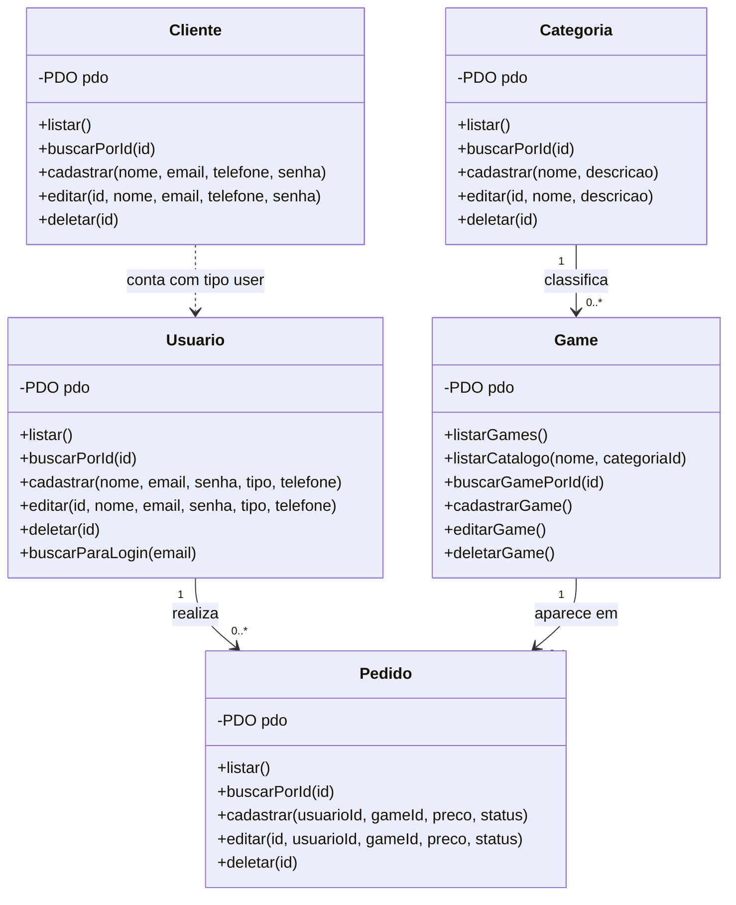
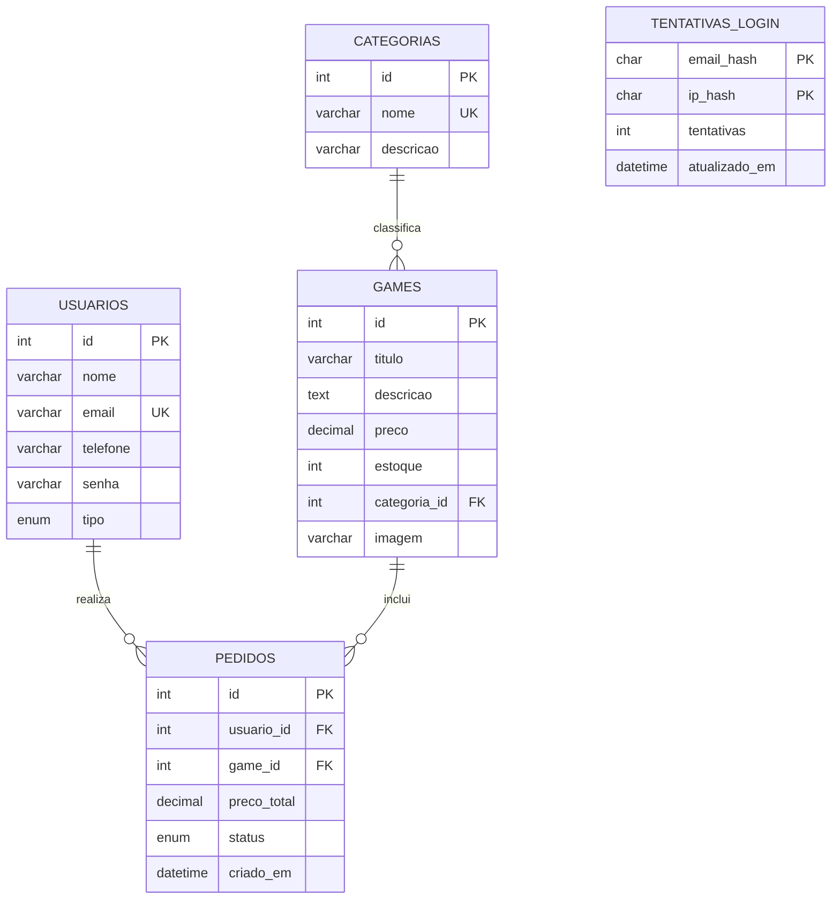

# Souls Store

## Identificação

- **Projeto:** Souls Store
- **Integrantes:** Pedro Henrique Santos Oliveira
- **Tema:** loja acadêmica de jogos soulslike, com atmosfera gótica e catálogo inspirado em Dark Souls, Elden Ring, Sekiro e Bloodborne.

## Descrição do sistema

A Souls Store é uma loja fictícia para apresentar um catálogo de jogos soulslike. Visitantes podem pesquisar e filtrar jogos, abrir detalhes, criar uma conta e entrar no sistema. Clientes autenticados podem adicionar jogos à biblioteca por meio de uma compra simulada, sem pagamento real. Administradores têm acesso a uma área restrita para gerenciar usuários, clientes, jogos, categorias e pedidos.

## Regras de negócio

1. Cada e-mail identifica uma única conta.
2. O cadastro público sempre cria uma conta de cliente (`tipo = user`); somente um administrador pode promover uma conta para `admin`.
3. Senhas são armazenadas com `password_hash()` e verificadas pelo fluxo de autenticação do PHP.
4. As páginas administrativas exigem sessão autenticada com perfil `admin`.
5. Todo jogo pertence a uma categoria. Uma categoria em uso não pode ser excluída.
6. Um cliente pode ter um pedido por jogo. Um pedido concluído representa a compra simulada e aparece na biblioteca; um pedido cancelado pode ser reativado.
7. O preço é registrado no pedido. Não há gateway, checkout ou cobrança real.
8. Clientes e pedidos vinculados a jogos/contas não podem ser removidos enquanto as chaves estrangeiras os protegerem.

## Tecnologias e arquitetura

- PHP 8.0 ou superior (validado no PHP 8.2);
- MySQL 8 ou compatível com o XAMPP instalado;
- PDO e `pdo_mysql` para consultas parametrizadas;
- Programação Orientada a Objetos nos modelos `Usuario`, `Cliente`, `Game`, `Categoria` e `Pedido`;
- organização MVC: Models em `admin/models/`, Controllers em `admin/controllers/` e Views administrativas em `admin/views/`; os arquivos PHP da raiz fazem a entrada das páginas públicas;
- HTML, CSS e JavaScript para a interface;
- sessões PHP, controle por perfil, proteção CSRF e `password_hash()` para as senhas.

## Diagrama de classes



`Cliente` é uma classe de CRUD própria para os clientes, mas clientes e administradores ficam na tabela `usuarios`, diferenciados pelo campo `tipo`.

## Modelo relacional do banco de dados



O script completo de instalação, com tabelas, chaves e dados iniciais, está em [`database/schema.sql`](database/schema.sql). Ele cria a categoria Soulslike, os seis jogos do catálogo e uma conta de cliente para demonstração. Para migrar uma base anterior, consulte [`database/migrations/academico_crud.sql`](database/migrations/academico_crud.sql).

## Instalação e execução com XAMPP

1. Copie a pasta do projeto para `C:\xampp\htdocs\loja_games`.
2. Inicie **Apache** e **MySQL** no painel do XAMPP.
3. No phpMyAdmin, importe `database/schema.sql`; o script cria o banco `loja_games`, as tabelas relacionais e os dados iniciais.
4. Acesse [`http://localhost/loja_games/`](http://localhost/loja_games/).

Por padrão, a conexão usa host `localhost`, porta `3306`, banco `loja_games`, usuário `root` e senha vazia. Para outro nome de banco, ajuste também as instruções `CREATE DATABASE` e `USE` no início do `schema.sql`, além de definir `DB_NAME`. As demais configurações podem ser definidas por `DB_HOST`, `DB_PORT`, `DB_USER` e `DB_PASSWORD`. PDO precisa estar habilitado com o driver `pdo_mysql`.

### Atualizar uma instalação existente

Antes de alterar um banco existente, exporte um backup pelo phpMyAdmin. Para a versão antiga que possui `compras` e `games.categoria` como texto, importe `database/migrations/academico_crud.sql` uma única vez. Não execute `database/migrations/souls_store.sql` nessa atualização: é um script legado que substitui o catálogo.

## Usuário e senha de demonstração

O `schema.sql` cria uma conta **cliente** local para demonstrar login, biblioteca e compra simulada:

- **E-mail:** `demo@souls.store`
- **Senha:** `SoulsDemo#2026`
- **Perfil:** cliente (sem acesso administrativo)

Essa credencial é pública e serve somente para a demonstração local do projeto. Não reutilize essa senha em contas pessoais nem publique uma instalação de produção com a conta de demonstração ativa. Para testar o painel, crie uma conta pela página **Criar conta** e, no phpMyAdmin, promova somente essa conta:

```sql
UPDATE usuarios SET tipo = 'admin' WHERE email = 'seu-email@exemplo.com';
```

Depois saia e entre novamente. A documentação complementar está em [`CONFIGURAR_ACESSOS.md`](CONFIGURAR_ACESSOS.md).

## Funcionalidades implementadas

- página pública com catálogo carregado do banco;
- cadastro, login, logout e sessão de cliente/administrador;
- CRUD de usuários, clientes, jogos, categorias e pedidos;
- busca e filtros do catálogo;
- detalhes interativos e lista de desejos;
- imagens de capa e controle de estoque no cadastro;
- compra simulada e biblioteca do cliente;
- painel administrativo com visão dos pedidos.

## Etapas da entrega

- **Etapa 1 — planejamento, modelagem e banco:** tema e descrição definidos; regras de negócio, diagramas UML/relacional e script de criação com chaves e dados iniciais documentados acima e em `database/schema.sql`.
- **Etapa 2 — estrutura e CRUDs principais:** conexão PDO, autenticação e sessão; organização MVC; home com catálogo do banco; cinco CRUDs disponíveis no painel; repositório GitHub criado e atualizado.
- **Etapa 3 — entrega final:** catálogo público, registro de clientes, autenticação, cinco CRUDs, compras simuladas, biblioteca, lista de desejos e relatório administrativo implementados.

## Capturas de tela

**Pendente para a apresentação:** anexar capturas feitas na instalação final, ocultando dados pessoais. Salve os arquivos abaixo em `docs/screenshots/` e inclua-os aqui:

1. `docs/screenshots/01-home.png` — página inicial e jogo em destaque;
2. `docs/screenshots/02-acervo-detalhes.png` — catálogo e detalhes de um jogo;
3. `docs/screenshots/03-login-cadastro.png` — telas de login e cadastro;
4. `docs/screenshots/04-painel-admin.png` — painel administrativo com os módulos de CRUD.

## Repositório

[github.com/pedraraunic-max/SOULS-STORE](https://github.com/pedraraunic-max/SOULS-STORE)
